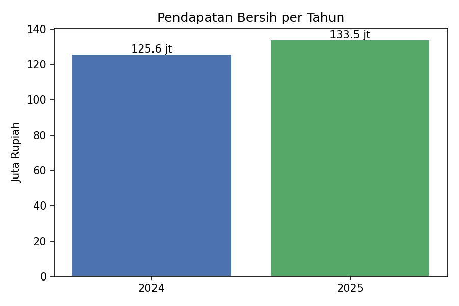

# Analisis Pendapatan Transaksi POS 2024–2025

Program Python (Jupyter Notebook) untuk menghitung total pendapatan per tahun dari data transaksi POS,
dengan memperhatikan diskon dan status transaksi.

## Struktur Repo
```
Analisis_Pendapatan_POS/
├── data/
│   ├── raw/          # data asli (tidak diubah)
│   └── processed/    # data hasil pembersihan
├── notebooks/
│   └── analisis_pendapatan_pos.ipynb
├── output/           # tabel & grafik hasil
├── requirements.txt
├── .gitignore
└── README.md
```

## Cara Menjalankan
1. Buka Anaconda Navigator / Anaconda Prompt, jalankan `jupyter notebook`
2. Buka `notebooks/analisis_pendapatan_pos.ipynb`
3. Pilih menu **Kernel → Restart & Run All**

## Aturan Perhitungan
- `pendapatan = jumlah × harga_satuan × (1 − diskon_persen/100)`
- Status `SELESAI` dihitung, `BATAL` diabaikan, `RETUR` dikurangkan
- Pembersihan: kasir kosong diisi `TIDAK_DIKETAHUI`, 30 duplikat dihapus, format tanggal & harga diseragamkan,
  `jumlah` negatif diubah jadi positif, 12 baris `jumlah` ekstrem (>12) dikeluarkan

## Hasil
| Tahun | Pendapatan SELESAI | Retur | Pendapatan Bersih |
|------:|-------------------:|------:|------------------:|
| 2024 | Rp 128.048.525 | Rp 2.432.575 | **Rp 125.615.950** |
| 2025 | Rp 136.467.375 | Rp 2.933.625 | **Rp 133.533.750** |


