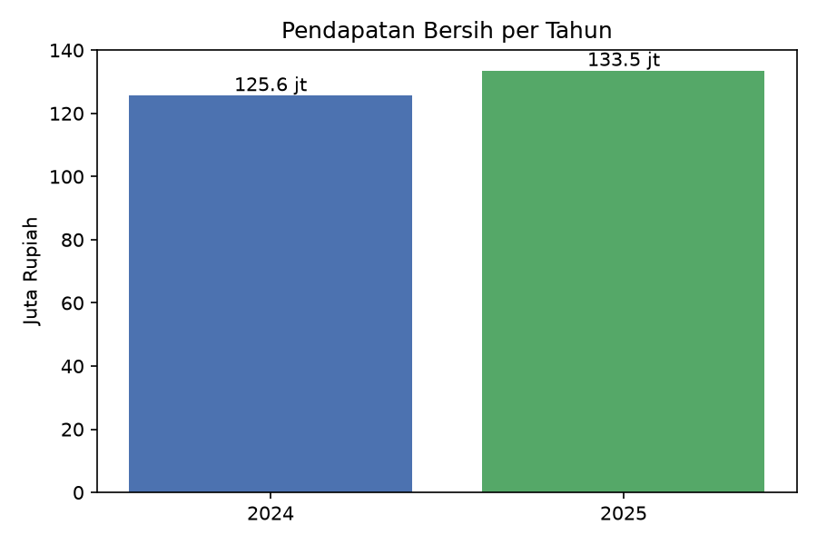
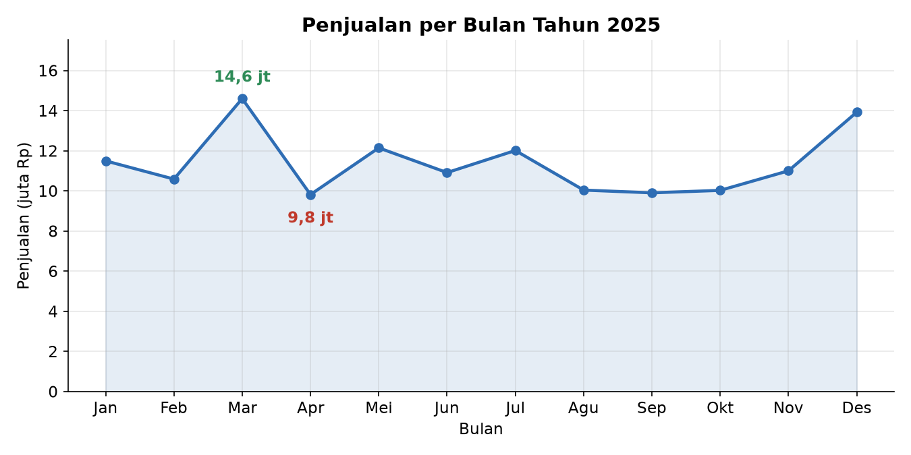
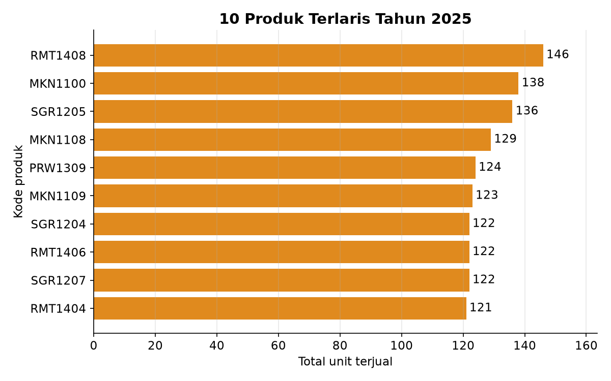
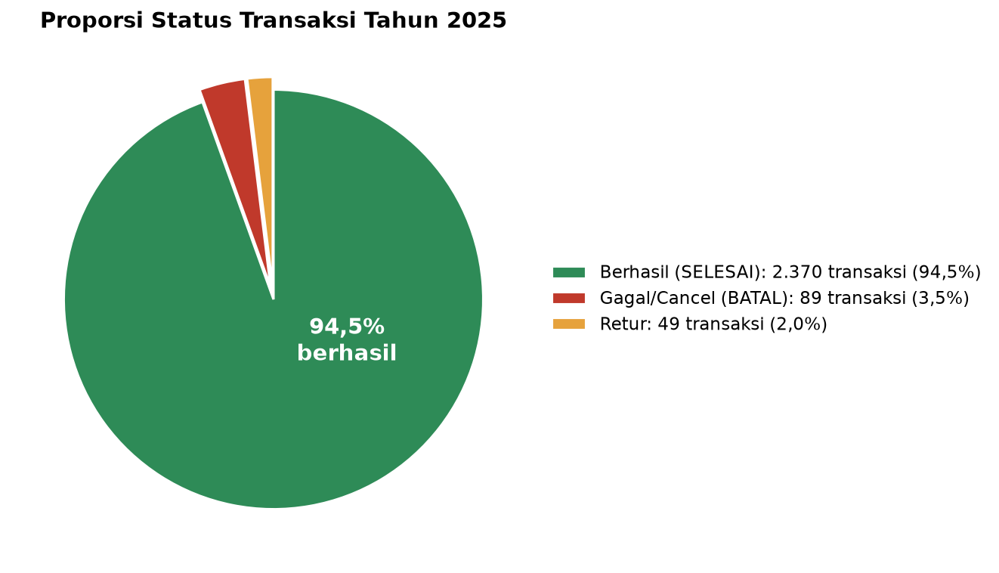
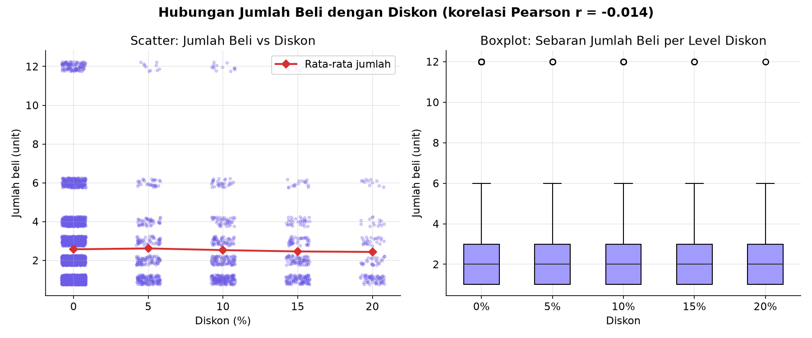

# Sains Data Analisis — Data Transaksi POS 2024–2025

Kumpulan tugas analisis data menggunakan Python (Pandas & Matplotlib) pada satu dataset transaksi *Point of Sale* (POS) periode 2024–2025.

## Daftar Tugas

| # | Tugas | Isi | Notebook |
|---|-------|-----|----------|
| 1 | Analisis Pendapatan | Pembersihan data dan total pendapatan per tahun (memperhatikan diskon & status) | [tugas_1_analisis_pendapatan](tugas_1_analisis_pendapatan/tugas_1_analisis_pendapatan.ipynb) |
| 2 | Manipulasi Data | Indexing, aritmatika (PPN 11%), filtering, sorting, groupby & transform | [tugas_2_manipulasi_data](tugas_2_manipulasi_data/tugas_2_manipulasi_data.ipynb) |
| 3 | Visualisasi Matplotlib | 4 visualisasi: penjualan bulanan, produk terlaris, status transaksi, jumlah vs diskon | [tugas_3_visualisasi_matplotlib](tugas_3_visualisasi_matplotlib/tugas_3_visualisasi_matplotlib.ipynb) |

## Struktur Repo

```
sains-data-analisis/
├── data/
│   ├── raw/                                   # data asli (tidak diubah)
│   └── processed/                             # data hasil pembersihan
├── tugas_1_analisis_pendapatan/
│   ├── tugas_1_analisis_pendapatan.ipynb
│   └── output/                                # tabel & grafik hasil tugas 1
├── tugas_2_manipulasi_data/
│   ├── tugas_2_manipulasi_data.ipynb
│   └── output/
├── tugas_3_visualisasi_matplotlib/
│   ├── tugas_3_visualisasi_matplotlib.ipynb
│   └── output/
├── requirements.txt
├── .gitignore
└── README.md
```

## Dataset

`data/raw/paket_a_transaksi_pos_2024_2025.csv` — 5.030 baris, 9 kolom:
`id_transaksi`, `tanggal`, `kode_gerai`, `kode_kasir`, `kode_produk`, `jumlah`, `harga_satuan`, `diskon_persen`, `status` (`SELESAI` / `BATAL` / `RETUR`).

### Masalah data & penanganannya

| Masalah | Penanganan |
|---------|-----------|
| `kode_kasir` kosong (261 baris) | Diisi `TIDAK_DIKETAHUI` (Tugas 2: `K_UNKNOWN`) |
| Baris duplikat persis (30 baris) | Dihapus |
| Format tanggal campuran (`2024-12-28`, `26/03/2025`, `23-12-2024`) | Diseragamkan |
| Format harga campuran (`13.000`, `7500,00`) | Dibersihkan menjadi angka |
| `kode_produk` berspasi / huruf kecil | `strip()` + `upper()` |
| `jumlah` negatif (41 baris) | Diambil nilai mutlaknya |
| `jumlah` ekstrem > 12 (12 baris; normalnya 1–12) | Dikeluarkan dari perhitungan Tugas 1 & 3 |

**Rumus pendapatan:** `jumlah × harga_satuan × (1 − diskon_persen / 100)`
Status `SELESAI` dihitung, `BATAL` diabaikan, `RETUR` dikurangkan.

## Hasil

### Tugas 1 — Pendapatan per Tahun

| Tahun | Pendapatan SELESAI | Retur | Pendapatan Bersih |
|------:|-------------------:|------:|------------------:|
| 2024 | Rp 128.048.525 | Rp 2.432.575 | **Rp 125.615.950** |
| 2025 | Rp 136.467.375 | Rp 2.933.625 | **Rp 133.533.750** |



### Tugas 2 — Kinerja Gerai

Hasil lengkap: [`laporan_gerai.csv`](tugas_2_manipulasi_data/output/laporan_gerai.csv) dan [`top5_transaksi.csv`](tugas_2_manipulasi_data/output/top5_transaksi.csv).
Gerai dengan omzet bersih (termasuk PPN 11%) tertinggi: **G11**, disusul G09 dan G06.

### Tugas 3 — Visualisasi

| | |
|:--:|:--:|
|  |  |
| **1. Penjualan per bulan 2025** | **2. 10 produk terlaris 2025** |
|  |  |
| **3. Proporsi status transaksi 2025** | **4. Jumlah beli vs diskon** |

Temuan singkat:
- Penjualan 2025 tertinggi di **Maret** (Rp 14,6 jt), terendah di **April** (Rp 9,8 jt).
- Produk terlaris berdasarkan unit terjual: **RMT1408** (146 unit).
- 94,5% transaksi 2025 berhasil, 3,5% batal, 2,0% retur.
- Korelasi jumlah beli dengan diskon ≈ 0 (r = −0,014): diskon lebih besar **tidak** membuat pembelian lebih banyak.

## Cara Menjalankan

1. Clone repo ini:
   ```
   git clone https://github.com/DeadBeats69/sains-data-analisis.git
   cd sains-data-analisis
   ```
2. Pasang library (jika belum, Anaconda sudah menyertakan sebagian besar):
   ```
   pip install -r requirements.txt
   ```
3. Jalankan `jupyter notebook`, buka salah satu notebook di folder tugas.
4. Pilih menu **Kernel → Restart & Run All**.

> Path data ditulis relatif (`../data/raw/...`), jadi notebook harus dijalankan dari dalam foldernya masing-masing (cukup dibuka lewat Jupyter).

## Teknologi
Python 3 · Pandas · Matplotlib · Jupyter Notebook
